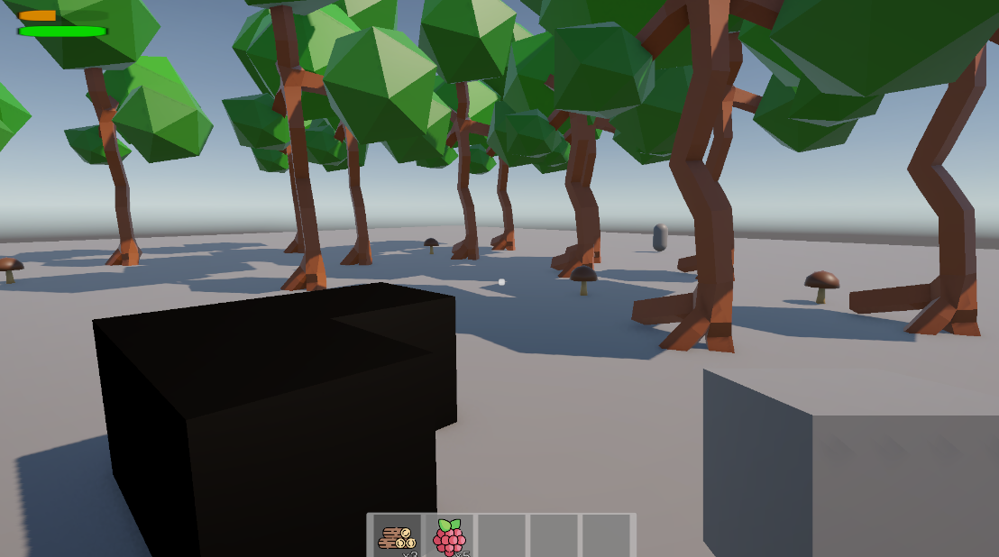
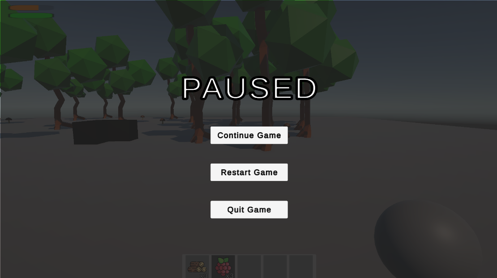

# Survival 3D


### A first-person survival game prototype built with Unity.


> 🚧 **Early prototype — on hold.** Gameplay systems come first; the visuals are placeholders (the player is still a capsule).

| Gathering in the forest | Placing blocks |
|:---:|:---:|
|  |  |
| **Pause menu** | |
|  | |

---

## What's in it

- **First-person controller** — movement, jumping and mouse look
- **Resource gathering** — chop trees for wood and pick mushrooms for food
- **Inventory & hotbar** — 5 slots with item stacking, selected with the number keys
- **Survival stats** — hunger drains over time and eating refills it; starving damages your health, while staying well-fed slowly regenerates it
- **Death screen & pause menu** — continue, restart or quit
- **Grid building** — place and remove blocks on a grid
- **Wildlife (in progress)** — a chicken that wanders around using NavMesh

## Controls

| Key | Action |
|---|---|
| `W` `A` `S` `D` | Move |
| `Space` | Jump |
| Mouse | Look around |
| `E` | Gather / interact |
| `1` – `5` | Select hotbar slot |
| Right click | Use held item (e.g. eat) |
| Left click | Place / remove a block |
| `Esc` | Pause |

## Running it

1. Install **Unity 6** (`6000.5.5f1`) via Unity Hub.
2. Clone the repo and open the folder in Unity Hub (**Add project from disk**).
3. Open `Assets/Scenes/SampleScene` and press **Play**.

## Project structure

```
Assets/
├── Scripts/    # all gameplay code (player, inventory, hunger, building, AI…)
├── Items/      # item definitions (ScriptableObjects)
├── Prefabs/    # trees, bushes, placeable blocks, held items
├── Models/     # 3D models
└── Scenes/     # SampleScene
```

## What I'm learning

- Structuring gameplay into small, single-purpose components (`Hunger`, `Health`, `Inventory`, `HotbarSelection`…)
- Data-driven items with **ScriptableObjects**
- Raycasting for interaction and grid placement
- Basic AI movement with **NavMesh**

---

**Victor Hugo** — [github.com/MarcondezVictor](https://github.com/MarcondezVictor)
